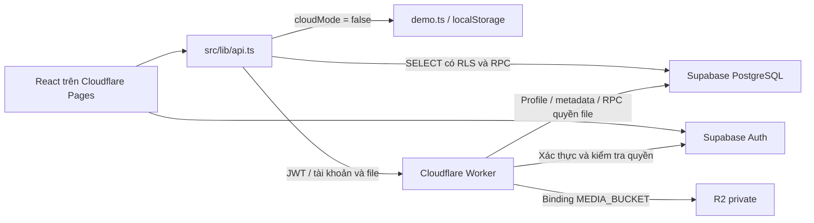

# LinguaNest — học cùng nhóm, luyện đề theo kỳ thi

**Quy ước bảo trì theo yêu cầu của chủ dự án:** mỗi lần thay đổi project, phải cập nhật README ngay trong cùng lần làm việc. Điều chỉnh các mục liên quan đến chức năng, mapping mã nguồn, dữ liệu, cấu hình, triển khai và kiểm thử để phản ánh đúng thay đổi; nếu thay đổi nhỏ không ảnh hưởng các mục này, ghi ngắn gọn nội dung thay đổi và cách kiểm tra. Không coi công việc đã hoàn tất khi README còn lệch với mã nguồn.

React + TypeScript + Tailwind / Cloudflare Pages; Supabase Auth + PostgreSQL; Worker quản lý tài khoản và học liệu Cloudflare R2 riêng tư.

README này vừa hướng dẫn vận hành, vừa là bản đồ để đọc và sửa project. Bản đồ được đối chiếu với mã nguồn ngày **24/10/2026**; đây không phải xác nhận rằng các dịch vụ đã được triển khai hoặc cấu hình trên tài khoản thật.

**Tra cứu nhanh:** [Bản đồ project](#project-map) · [Mapping yêu cầu → nơi sửa](#change-map) · [Hợp đồng dữ liệu và luồng xử lý](#data-flows) · [Quy trình thay đổi và kiểm tra](#change-workflow). Phần chạy local, cấu hình Supabase/R2 và thao tác soạn nội dung nằm bên dưới.

Định hướng hiện tại: web cho nhóm nhỏ khoảng 10 người, tài khoản nội bộ do admin cấp, học lý thuyết/từ vựng/nghe và luyện đề tự soạn. **R2 là nơi lưu file; Supabase chỉ dùng Auth, PostgreSQL và metadata file.** Flashcard đã bỏ khỏi luồng sử dụng. Chưa có app native, service worker để học offline hoặc cơ chế đồng bộ dữ liệu demo lên cloud.

## Chạy trên máy

Node.js 22.12+ (đã kiểm tra với Node 24). Trên PowerShell có ExecutionPolicy hạn chế, dùng `npm.cmd` thay cho `npm`.

```sh
npm ci
npm run dev
```

Không có biến môi trường Supabase: ứng dụng chạy **demo**, lưu nội dung/bài làm trong localStorage của trình duyệt. Dữ liệu này không đồng bộ giữa người dùng hoặc thiết bị. Demo không upload Cloudflare R2, tạo tài khoản thật hoặc đổi mật khẩu. Không dùng demo làm hệ thống nhóm chính thức. Nội dung/bài kiểm tra minh họa cũ được chuyển sang giao diện mới trong trình duyệt; nội dung demo không tự chuyển lên database.

## Chức năng

- Tài khoản nội bộ do quản trị cấp; tên đăng nhập, mật khẩu; đổi tên hiển thị và mật khẩu. Mật khẩu tạm bắt buộc đổi trước khi học. Quên mật khẩu: liên hệ quản trị, không cần SMTP.
- Bài học: tạo, sửa, lưu nháp, xem trước, xuất bản, lưu trữ và nhân bản; từ vựng nhập bằng form hoặc CSV; nhiều học liệu đính kèm.
- Đề thi: phân loại theo ngôn ngữ và kỳ thi. Mặc định IELTS/TOEIC/Cambridge, DELF/DALF/TCF, HSK/HSKK, JLPT/J.TEST; quản trị có thể thêm loại mới. Mỗi bài học có thể gắn một đề bài tập; đề luyện thi độc lập không giới hạn theo bài học.
- Đề thi thử 1–300 phút hoặc luyện tập không giới hạn giờ, tối đa 200 câu; có phần, nhóm dùng chung học liệu và câu hỏi. Hỗ trợ chọn một/nhiều đáp án, điền từ, nhiều ô trống, nối thông tin và tự luận.
- Nhập CSV có mẫu, xem trước và lỗi theo dòng; bản nháp người soạn tự lưu trên máy. Lưu bản nháp lên máy chủ bằng nút Lưu để làm tiếp trên thiết bị khác.
- Đề được chấm trên PostgreSQL. Đáp án không được gửi tới học viên đang làm bài. Trắc nghiệm nhiều đáp án chỉ nhận điểm khi chọn đúng toàn bộ tập đáp án. Điền nhiều ô/nối chia đều điểm cho các mục (điểm tối đa phải chia hết số mục); điền từ so sánh Unicode NFC, bỏ khoảng trắng thừa và không phân biệt hoa/thường, vẫn phân biệt dấu và dấu câu. Tự luận chấm thủ công, có nhận xét.
- Lưu bài làm tự động, tiếp tục từ lịch sử, kiểm tra xung đột giữa các thiết bị; đồng hồ vẫn chạy khi rời trang. Khi hết giờ, máy chủ chấm các câu đã lưu trước hạn. Không nhận thay đổi đến sau hạn; nếu mất mạng lúc hết giờ, cần kết nối lại và nộp hoặc mở lại lượt làm.
- Mỗi lượt làm giữ nguyên câu hỏi, đáp án, điểm tối đa, file đính kèm và phiên bản tại lúc bắt đầu. Sửa đề không thay đổi lượt cũ. Nộp lại một lượt đã nộp không tạo thêm điểm.
- XP tổng hợp toàn bộ lịch sử, độc lập với phân trang: 20 XP cho lần đầu hoàn thành bài học; 5 XP/điểm đề đã chấm xong. Điểm tạm tính của bài chờ tự luận chưa cộng XP. Điểm cũ được giữ lại (không thể kiểm chứng lại vì phiên bản cũ do client chấm).
- Cloudflare R2: upload nhiều file lần lượt, tìm kiếm, xem trước, tái sử dụng, gỡ liên kết và xóa file không dùng. MP3 ≤30 MB, PDF ≤20 MB, JPG/PNG/WebP ≤5 MB. File đang được bài học, đề hoặc lịch sử tham chiếu không thể xóa.
- Quản trị: cấp/khóa/mở tài khoản thành viên, đặt lại mật khẩu tạm, xem số bài/đề/XP của từng người và chấm tự luận.

**Điểm đề luyện tập không tự quy đổi thành band IELTS, điểm TOEIC/HSK/JLPT hoặc chứng chỉ chính thức.** Có mẫu cấu trúc TOEIC L&R truyền thống và IELTS theo kỹ năng; đây là khung trống, cần điền và chia nhóm theo đề cụ thể. Không mô phỏng khóa phần hay nghe một lần của kỳ thi chính thức. Đồng hồ thi thử tính toàn đề; có thể chuyển phần và nghe lại. Bài mẫu/transcript hiện sau khi nộp; rubric chỉ dành cho quản trị. Tự luận ở đây là câu trả lời văn bản; chưa có ghi âm/chấm Speaking. Tính năng flashcard đã bỏ khỏi ứng dụng; bảng lịch sử cũ được giữ nhưng không còn quyền truy cập từ frontend.

## Cấu hình Supabase

### Dự án mới

Chạy trong SQL Editor theo đúng thứ tự:

1. `supabase/001_schema.sql`
2. `supabase/002_seed.sql`
3. `supabase/003_learning_platform.sql`
4. `supabase/004_structured_content.sql`

### Nâng cấp dự án cũ

Sao lưu trước. Nếu đã chạy 003: chạy **004**, không chạy lại 001–003. Nếu mới có 001/002: chạy **003 → 004**. Migration 004 thêm cấu trúc nội dung và cách chấm mới; không viết lại snapshot/lịch sử cũ. Bài học cũ được hiển thị thành khối khi mở; lưu lần đầu sẽ ghi cấu trúc mới. Không chạy lại 001 sau các migration mới vì sẽ khôi phục chính sách phân quyền cũ.

Nếu đã chạy 004 thì chuyển sang R2 không cần migration database mới: bảng `media_files` vẫn lưu key, tên file và quyền tham chiếu. `005_private_storage.sql` được giữ lại cho hệ thống từng dùng Supabase Storage; **không cần chạy 005 cho R2**. Nếu đã chạy 005, giữ nguyên bucket/policy cũ trong thời gian chuyển file; không cần xóa dữ liệu hay hoàn tác migration.

Nếu có file thật trong Supabase Storage, xem mục chuyển học liệu sang R2 bên dưới trước khi triển khai Worker mới. SQL không sao chép nội dung file.

Migration 003 đóng quyền ghi trực tiếp điểm, lịch sử, vai trò. Các thao tác đi qua RPC có kiểm tra người dùng/quyền. Đáp án và snapshot chỉ đọc qua API được kiểm soát. Tài khoản mới có trạng thái chưa duyệt mặc định; chỉ tài khoản quản trị cấp mới được kích hoạt.

Trong Supabase Authentication:

- Tắt **Allow new users to sign up** và đăng nhập ẩn danh.
- Tài khoản nội bộ do Worker tạo với `email_confirm: true`; không dùng luồng gửi thư mời/xác nhận/reset password qua email.
- Không bật yêu cầu xác thực đổi mật khẩu bằng mã gửi email cho luồng này. Worker kiểm tra mật khẩu hiện tại trực tiếp rồi đổi mật khẩu.

Tạo tài khoản quản trị đầu tiên trong Auth Dashboard với email/mật khẩu và xác nhận sẵn. Chạy SQL sau, thay email của bạn:

```sql
UPDATE public.profiles
SET role='admin', is_active=true, must_change_password=false
WHERE id=(SELECT id FROM auth.users WHERE email='YOUR_ADMIN_EMAIL');
```

Đăng nhập bằng email đó. Từ **Quản trị → Thành viên**, cấp tài khoản mới. Tên đăng nhập như `minh.nguyen` được ánh xạ nội bộ sang `minh.nguyen@users.linguanest.invalid`; không phải hộp thư thật. Không tự thay email định danh của tài khoản nội bộ qua Auth Dashboard. Tài khoản cũ dùng email vẫn đăng nhập được.

Tạo `.env` từ `.env.example`:

```dotenv
VITE_SUPABASE_URL=https://YOUR_PROJECT.supabase.co
VITE_SUPABASE_ANON_KEY=YOUR_PUBLIC_ANON_OR_PUBLISHABLE_KEY
VITE_MEDIA_WORKER_URL=https://linguanest-media.YOUR_SUBDOMAIN.workers.dev
```

Các biến `VITE_*` xuất hiện trong frontend; **không đặt secret/service-role key hoặc mật khẩu database vào đó**.

## Worker và Cloudflare R2

1. Trong Cloudflare → R2 Object Storage, tạo bucket **`linguanest-media`**. Giữ riêng tư: không bật Public Development URL (`r2.dev`) hoặc custom domain công khai cho bucket. Tài khoản Cloudflare cần kích hoạt được R2 trước khi triển khai; đổi mã nguồn không thay thế bước này.
2. Sửa `media-worker/wrangler.jsonc`:
   - `r2_buckets`: giữ `binding` là **`MEDIA_BUCKET`**, đặt `bucket_name` đúng tên bucket đã tạo.
   - `SUPABASE_URL`, `SUPABASE_ANON_KEY`: cùng project với frontend.
   - `ALLOWED_ORIGINS`: các origin chính xác, ví dụ `http://localhost:5173,https://YOUR_PROJECT.pages.dev`; không thêm dấu `/` cuối.
3. Cài dependencies, đặt secret Supabase cho Worker và triển khai:

```sh
cd media-worker
npm ci
npm run check
npx wrangler login
npx wrangler secret put SUPABASE_SERVICE_ROLE_KEY
npm run deploy
```

Worker truy cập R2 qua binding, không cần R2 Access Key/S3 secret trong frontend hoặc Worker. Không cần CORS trên bucket vì trình duyệt chỉ gọi Worker; CORS được kiểm soát bằng `ALLOWED_ORIGINS`. Supabase tiếp tục quản lý tài khoản, database và metadata học liệu.

Secret Supabase chỉ nằm ở Worker. Có thể dùng legacy service-role JWT hoặc secret key mới của project. Không ghi vào wrangler.jsonc hoặc Git. Wrangler và Workers types được ghim phiên bản tương thích, có lockfile riêng.

### Thử local trước khi triển khai

- **Thử giao diện:** chạy `npm run dev` ở thư mục gốc khi chưa đặt biến Supabase, dùng demo localStorage như trước; chưa upload file thật lên R2.
- **Thử Worker với R2 giả lập local:** cấu hình Supabase trong `media-worker/wrangler.jsonc`, tạo file `media-worker/.dev.vars` chứa `SUPABASE_SERVICE_ROLE_KEY=...`, rồi chạy `npm run dev` trong `media-worker`. Wrangler dùng R2 local khi không bật `remote`; không cần bucket thật cho bước này. File local không tự được đưa lên R2 khi deploy.
- Khi thử Worker, frontend cần `.env` có cùng Supabase URL/public key và `VITE_MEDIA_WORKER_URL=http://localhost:8787`; khởi động lại Vite. Worker vẫn gọi Auth/database Supabase đã cấu hình, nên dùng project thử nghiệm với migrations 001–004 và tài khoản admin. Đây không phải chế độ hoàn toàn offline. `.dev.vars` đã được bỏ qua bởi Git.
- `npm test` kiểm tra upload/đọc/xóa với R2 mock và PostgreSQL nhúng, không cần tài khoản dịch vụ.

### Chuyển học liệu đã có từ Supabase Storage sang R2

Nếu chỉ dùng demo hoặc chưa upload file thật thì bỏ qua mục này.

1. Tạm dừng quản trị upload/xóa file trong thời gian chuyển; sao lưu database và file gốc.
2. Tải các object của bucket cũ về và sao chép sang R2, giữ **nguyên object key** (ví dụ `files/<uuid>.mp3`) và `Content-Type`. Không thêm tên bucket vào key. Chuyển cả file được lịch sử làm bài tham chiếu, không chỉ học liệu đang xuất bản.
3. Đối chiếu key, số lượng, kích thước và nội dung file với bản gốc; giữ nguyên các bản ghi `media_files` và tham chiếu trong database.
4. Triển khai Worker mới với binding R2; thử bằng admin và thành viên: xem ảnh, nghe/tua MP3, tải PDF, mở lượt thi cũ, upload và xóa file thử không dùng.
5. Giữ bản cũ để khôi phục khi cần. Ứng dụng không tự chuyển file, xóa bucket cũ hoặc đọc dự phòng từ Supabase Storage.

Worker xác thực session với Supabase, đọc trạng thái thành viên và quyền quản trị từ database. Học liệu dùng URL ký ngắn hạn (15 phút), gắn với người dùng và file. Mỗi lần đọc vẫn kiểm tra tài khoản và quyền tham chiếu file; biết đường dẫn không đủ để đọc bài nháp. Người đã bắt đầu một lượt đề tiếp tục được đọc file của snapshot đó để bảo toàn lịch sử. MP3 hỗ trợ HTTP Range; giao diện tạo player mới khi đổi bài. Nếu liên kết hết hạn, bấm Tải lại file.

Upload kiểm tra kích thước theo luồng đọc và chữ ký định dạng. Nếu lưu metadata thất bại, Worker dọn file vừa upload. Nếu thao tác xóa Cloudflare R2 thất bại sau khi khóa metadata, file ở trạng thái `deleting`; quản trị bấm Xóa file lại để hoàn tất. File được tham chiếu trong khối bài học, phần, nhóm hoặc câu đều được kiểm tra quyền và bảo vệ khỏi xóa; lượt làm cũ tiếp tục giữ file của snapshot.

## Triển khai Cloudflare Pages

- Build: `npm ci && npm run build`
- Output: `dist`
- Cấu hình 3 biến `VITE_*` ở môi trường production.
- Thêm origin Pages vào Worker rồi triển khai lại Worker.
- `public/_redirects` cung cấp SPA fallback.

Sau triển khai, kiểm tra bằng một admin và hai thành viên thật: đổi mật khẩu tạm, khóa tài khoản, không đọc dữ liệu của nhau, upload/nghe/tải tài liệu, tạo đề nháp/xuất bản, làm bài trên hai thiết bị, nộp và chấm tự luận. Các kiểm thử local không thay thế việc kiểm tra cấu hình trên dịch vụ thực tế.

## Kiểm thử

```sh
npm run check
npm run build
npm run validate:data
npm test
npm run test:ui
```

`npm test`: kiểm tra CSV, Worker bằng mock dịch vụ, và chạy migrations/RLS/RPC trên PostgreSQL nhúng PGlite. Auth được mô phỏng; kiểm thử riêng migration Storage cũ dùng schema mô phỏng; không gọi project thật, không sửa dữ liệu thật.

`npm run test:ui`: Playwright dùng Microsoft Edge đã cài, chạy luồng demo ở desktop và viewport điện thoại. Nếu máy không có Edge, cài browser Playwright và đổi `channel` trong `playwright.config.ts`. Ảnh/trace lỗi lưu ở `test-results`. Server kiểm thử dùng port 4173, được mở/đóng ngay trong tiến trình kiểm thử để không treo khi dọn tiến trình Windows. Cấu hình kiểm thử ép chế độ demo, không dùng thông tin kết nối dịch vụ trong `.env`.

## Sao lưu và vận hành

- Giữ các SQL migrations và lockfile trong Git.
- Xuất PostgreSQL định kỳ bằng Supabase CLI/pg_dump theo hướng dẫn Dashboard; lưu ở nơi riêng có quyền truy cập hạn chế, thử phục hồi vào project thử nghiệm. File database không chứa nội dung Cloudflare R2.
- Giữ bản gốc audio/ảnh/PDF và bản sao Cloudflare R2 ở nơi khác. Việc lưu trữ bài học/đề không xóa lịch sử.
- Theo dõi dung lượng/lượt thao tác R2, quota Supabase và Workers; mã không tự nâng gói hoặc đặt trần hóa đơn cho tài khoản dịch vụ.
- Bản nháp tự lưu trên máy có thể mất khi xóa dữ liệu trình duyệt; lưu bản nháp lên máy chủ để giữ lâu dài.

<a id="project-map"></a>

## Bản đồ project cho người phát triển

### Điểm bắt đầu và kiến trúc

Thư mục gốc ứng dụng là `linguanest/`; các đường dẫn trong README tính từ thư mục này. Frontend và Worker có `package.json`, `package-lock.json`, `tsconfig.json` riêng. Không có backend Express/Next.js hoặc ORM; schema, phân quyền và nghiệp vụ cloud nằm trong SQL và Worker.



- [src/main.tsx](src/main.tsx) gắn React vào DOM, import `styles.css` trước `platform.css`.
- [src/App.tsx](src/App.tsx) dùng state `Page`, `lang`, `lessonId`, `run`, `adminTab` để điều hướng; **chưa dùng React Router**. Thêm màn hình cần cập nhật state/nav và nhánh render tương ứng. Trang admin được lazy-load.
- [src/lib/supabase.ts](src/lib/supabase.ts) bật `cloudMode` khi có cả URL và public key. Thiếu `VITE_MEDIA_WORKER_URL` không tắt cloudMode: nội dung DB vẫn có thể chạy, thao tác Worker báo thiếu cấu hình. Khi đổi `.env`, khởi động lại Vite hoặc build lại frontend.
- [src/lib/api.ts](src/lib/api.ts) là điểm nối UI với demo/cloud. `loadContent()` tải courses, lessons, vocabulary, exams, exam_types; helper `all()` đọc theo lô 500 rồi gom vào bộ nhớ. Hiện tìm kiếm/lọc nội dung chủ yếu ở client; nếu tăng quy mô lớn, đây là điểm cần phân trang/lọc phía server.

### File và trách nhiệm

| File | Chức năng / điểm tìm nhanh |
| --- | --- |
| [src/App.tsx](src/App.tsx) | `Login`, session/profile gate, dashboard, `LessonPage`, `ExamCatalog`, `Listening`, `History`; tải lại nội dung và XP sau thao tác. |
| [src/components/ContentAdmin.tsx](src/components/ContentAdmin.tsx) | Danh sách/tìm kiếm bài và đề, tạo/nhân bản/lưu trữ, thêm loại kỳ thi; `LessonEditor` soạn bài và từ vựng; mở `ExamEditor`. |
| [src/components/LessonBlocks.tsx](src/components/LessonBlocks.tsx) | `BlockEditor`, `LessonContent`, `RichText`, `QuickQuiz`: soạn và hiển thị khối lý thuyết, bảng, công thức, ví dụ, media, bài tập nhanh. |
| [src/components/ExamEditor.tsx](src/components/ExamEditor.tsx) | Cây phần/nhóm/câu, chọn câu để sửa, mẫu đề, nhập CSV, xem trước, lưu nháp/xuất bản; `prepare()` gán nhóm cho câu cũ/CSV, `ordered()` sắp câu theo layout. |
| [src/components/AuthoringFields.tsx](src/components/AuthoringFields.tsx) | `QuestionFields` sửa nội dung/đáp án/rubric; `MediaPicker` upload hoặc chọn học liệu đã có. |
| [src/components/ExamPlayer.tsx](src/components/ExamPlayer.tsx) | Làm bài và xem kết quả, điều hướng câu, học liệu ghim phía trên câu hỏi khi cuộn, tab mobile, đồng hồ, hàng đợi autosave, nộp bài, cờ xem lại. Bố cục nằm ở `.reading-layout`/`.reading-source` trong `platform.css`; `ResizeObserver` trong player đo chiều cao thanh thời gian và khung học liệu để tính vị trí ghim và khoảng cuộn tới câu. |
| [src/components/Common.tsx](src/components/Common.tsx) | `QuestionBody` nhập câu trả lời; `Media`/`AttachmentList` phát/đọc file; `Speak` dùng speechSynthesis của trình duyệt; `CsvImport`, `useDraft`, thông báo dùng chung. |
| [src/components/OperationsAdmin.tsx](src/components/OperationsAdmin.tsx) | `MediaAdmin` thư viện/xóa file; `MembersAdmin` cấp/khóa/reset tài khoản; `GradingAdmin` chấm tự luận. |
| [src/components/Account.tsx](src/components/Account.tsx) | Đổi tên hiển thị và mật khẩu, gồm luồng bắt buộc đổi mật khẩu tạm. |
| [src/lib/types.ts](src/lib/types.ts) | Hợp đồng TypeScript: Lesson/Question/ExamLayout/ExamDocument/ExamRun/Profile; `Lang`, `LANG_DETAILS` chứa bốn ngôn ngữ và giọng đọc. |
| [src/lib/content.ts](src/lib/content.ts) | `parseCSV`, `importCSV`, `validateQuestions`, `newQuestion`, `normalizeAnswer`, `loginIdentity`; validation frontend và quy ước CSV. |
| [src/lib/authoring.ts](src/lib/authoring.ts) | `lessonBlocks`/`layoutOf` tương thích dữ liệu cũ; `templateDocument` khung đề; `scoreQuestion`/`correctAnswer` chấm demo và bài tập nhanh; `lessonMedia`/`nestedMedia` gom key. |
| [src/lib/demo.ts](src/lib/demo.ts) | Kho demo, CRUD, snapshot lượt làm, chấm điểm và XP bằng localStorage. Cần đối chiếu khi thay nghiệp vụ cloud; không thay thế kiểm thử RLS. |
| [src/styles.css](src/styles.css), [src/platform.css](src/platform.css) | Styles nền, sau đó styles mở rộng cho nền tảng/biên soạn/làm đề. Có CSS cũ còn lưu; thấy class flashcard không có nghĩa tính năng còn hoạt động. |
| [media-worker/src/index.ts](media-worker/src/index.ts) | Router HTTP, xác thực/profile gate, tài khoản nội bộ, ticket HMAC, kiểm tra upload, R2 put/get/head/delete và HTTP Range. |
| [media-worker/wrangler.jsonc](media-worker/wrangler.jsonc) | Binding R2 `MEDIA_BUCKET`, bucket `linguanest-media`, Supabase public config, CORS `ALLOWED_ORIGINS`; secret được đặt riêng. |
| [src/data/demo.json](src/data/demo.json) | Seed demo theo cấu trúc cũ (courses/lessons/vocabulary/exercises), được `demo.ts` chuyển sang đề khi khởi tạo. Không phải dữ liệu cloud. |
| [tools/validate-data.mjs](tools/validate-data.mjs) | Kiểm tra ID, quan hệ và câu hỏi seed demo; không kiểm tra toàn bộ schema nội dung mới. |
| [tools/upgrade-authoring.py](tools/upgrade-authoring.py) | Script đã dùng để sinh `004_structured_content.sql` từ một phần `003` và SQL nhúng. Chạy lại sẽ ghi đè file 004; không phải lệnh khởi động hay nâng cấp thường ngày. |
| [vite.config.ts](vite.config.ts), [public/_redirects](public/_redirects) | Vite React/Tailwind, chia bundle; SPA fallback trên Pages. |

### Database: đọc file nào trước

| Migration | Vai trò hiện tại |
| --- | --- |
| [001_schema.sql](supabase/001_schema.sql) | Bảng nền, Auth trigger tạo profile và cấu trúc học cũ. Policy tại đây không phải policy cuối cùng. |
| [002_seed.sql](supabase/002_seed.sql) | Nội dung mẫu cho database mới. Sửa seed không tự cập nhật nội dung của project đã triển khai. |
| [003_learning_platform.sql](supabase/003_learning_platform.sql) | Accounts gate, bảng đề/phiên bản/lượt làm/media, RLS và quyền RPC; nâng cấp bài tập cũ, lịch sử, XP, chấm tự luận, quyền/xóa file. |
| [004_structured_content.sql](supabase/004_structured_content.sql) | Blocks/layout, chế độ luyện tập, validation/chấm dạng câu mới, gom media lồng nhau; ghi đè các RPC soạn bài/đề và xử lý lượt làm. |
| [005_private_storage.sql](supabase/005_private_storage.sql) | Legacy, chỉ cho bucket Supabase Storage cũ; không cần cho R2. Giữ nguyên số migration đã tồn tại. |

**Logic hiện hành:** `save_lesson`, `save_exam`, `get_exam_document`, `start_exam`, `run_payload`, `submit_exam` lấy bản trong **004**. `save_exam_responses`, `get_exam_run`, `grade_exam`, `list_exam_runs`, `complete_lesson`, `learning_summary`, `member_summaries`, `can_access_media_for`, `reserve_media_delete` vẫn lấy từ **003**. Không sửa riêng bản hàm trong 003 rồi kỳ vọng hành vi đã được 004 ghi đè sẽ thay đổi.

<a id="data-flows"></a>

## Hợp đồng dữ liệu và luồng xử lý

### Mô hình nội dung

- `courses → lessons → vocabulary`. `lessons.blocks` chứa các khối `text/formula/table/example/note/media/quiz`. Trường `body` của khối bảng là chuỗi: hàng ngăn bằng newline, ô ngăn bằng tab; hàng đầu là tiêu đề. Xem `BlockEditor` và `LessonContent` trước khi thay định dạng. `lessonBlocks()` chuyển các trường bài cũ sang khối để hiển thị/biên tập. Khi lưu bài, editor tổng hợp transcript vào `listening_text`; trang Luyện nghe trong `App.tsx` vẫn dựa trên trường này.
- `exam_types → exams → exam_versions`. `exams` chứa thông tin danh sách và version hiện tại, không chứa đáp án. `exam_versions` giữ `questions` và `layout` theo version. Một lesson gắn tối đa một exam qua `exams.lesson_id UNIQUE`; đề độc lập có `lesson_id = null`.
- `ExamLayout.sections[] → groups[] → Question.group_id`; nhóm trỏ tới phần bằng `section_id`. `Question.section` là nhãn tương thích, không thay thế quan hệ ID. Câu hỏi lưu trong JSONB, không có bảng `questions` riêng.
- Học liệu có thể nằm ở toàn đề, phần, nhóm, câu hoặc khối bài học. `content_media_keys()` trong 004 gom các `media_keys` lồng nhau cho backend; SQL giữ `root_media_keys` trong layout phiên bản để phân biệt học liệu chung toàn đề với tập key tổng hợp. Client không được tự coi tập key tổng hợp là học liệu chung.
- `exam_runs` giữ snapshot tại lúc bắt đầu, responses, grades, revision và deadline. Không đọc lại câu hỏi phiên bản mới để hiển thị/chấm lượt cũ. `media_files` chỉ lưu metadata/key/trạng thái; bytes nằm trong R2. Các bảng `exercises`, `quiz_attempts`, `flashcard_reviews` là di sản; frontend không đọc/ghi trực tiếp.

### Câu trả lời, CSV và chấm điểm

`Question.answers` là đáp án mẫu dạng mảng chuỗi; **`ExamRun.responses` là map `questionId → string`**, kể cả với câu nhiều lựa chọn/nhiều ô. Không thay thẳng giá trị responses bằng mảng JSON nếu chưa đổi toàn bộ UI, demo và SQL.

| Dạng | `Question.answers` ví dụ | Chuỗi lưu trong `responses[questionId]` |
| --- | --- | --- |
| `choice` | `["1"]` (B, chỉ số từ 0) | `"1"` |
| `multi` | `["0","2"]` | `JSON.stringify(["0","2"])` |
| `short` | `["hanoi","ha noi"]` (cách viết thay thế) | Văn bản người dùng nhập. |
| `gaps` | `["hanoi\|ha noi","blue"]` (đáp án từng ô) | `JSON.stringify(["Hanoi","blue"])` |
| `matching` | `["2","1"]` (lựa chọn từ 1) | `JSON.stringify(["2","1"])` |
| `essay` | `[]` hoặc không có | Văn bản tự luận; điểm null khi chờ quản trị. |

Header CSV câu hỏi hiện tại:

```csv
kind,section,prompt,passage,choices,answers,points,explanation,slots,word_limit
```

`importCSV()` yêu cầu tối thiểu các cột `kind,prompt,points`; các dạng câu vẫn phải có lựa chọn/đáp án tương ứng để qua validation. Mẫu tải trong web nằm ở `CsvImport` trong `Common.tsx`; parser/kiểm tra nằm ở `content.ts`. Import chỉ **thêm** câu vào bản nháp, không nhập metadata toàn đề, ID nhóm, rubric hoặc file. `prepare()` phân nhóm theo `section`, sau đó admin chỉnh nhóm/học liệu trên web. File tối đa 2 MB ở UI, đề tối đa 200 câu. Khi đổi hợp đồng CSV cần sửa parser, mẫu tải, lời hướng dẫn và kiểm thử cùng nhau.

Chấm thật: `submit_exam → score_question_v4 → answer_equal_v4` trong 004. Chấm demo: `demoSubmit → scoreQuestion` trong JS. Bài tập nhanh dùng `correctAnswer`, hiện đáp án để tự học và không cộng điểm thi. Multi đúng toàn bộ mới có điểm; gaps/matching chia đều điểm theo mục; short/gaps có giới hạn từ. Không dùng validation hoặc điểm client làm nguồn tin cậy cho cloud.

### Các luồng cần giữ khi sửa

| Luồng | Chuỗi xử lý và điều kiện cần giữ |
| --- | --- |
| Đăng nhập | `Login → loginIdentity → Supabase Auth → loadProfile`. Kiểm tra `is_active` và `must_change_password` ở cả giao diện, SQL và Worker. Profile `role` từ database quyết định quyền. |
| Cấp/reset tài khoản | `MembersAdmin → workerJSON → /admin/users`, `/admin/users/reset`, `/admin/users/status`. Worker dùng Auth Admin API; thành viên phải đổi mật khẩu tạm. |
| Đổi mật khẩu | `Account → /account/password`; Worker xác minh mật khẩu hiện tại rồi cập nhật Auth và bỏ cờ `must_change_password`. Đổi tên đi qua RPC `update_my_profile`. |
| Lưu bài học | `LessonEditor → saveLesson → save_lesson` (004), ghi bài và từ vựng trong một giao dịch, kiểm tra blocks và key file; demo dùng `demoLesson`. |
| Lưu đề | `ExamEditor → saveExam → save_exam` (004), kiểm tra version chống ghi đè từ tab khác, tạo version mới; admin tải đầy đủ qua `get_exam_document`. Nháp cho nội dung chưa hoàn thiện, xuất bản kiểm tra nghiêm hơn. |
| Bắt đầu / tiếp tục | `App.openExam → startExam/getRun → start_exam/get_exam_run`. Mỗi user chỉ có một lượt `in_progress` cho cùng exam; lượt mới chụp snapshot. `practice` có deadline null; `mock` có hạn toàn đề. |
| Autosave / nộp | `ExamPlayer` debounce 600 ms, nối hàng đợi Promise, gửi `revision`; server khóa hàng và tăng revision. Khi nộp, đợi hàng đợi trước rồi gọi `submit_exam`. Sau hạn chỉ chấm câu đã lưu trước hạn. Đồng hồ UI dùng `server_now`, không quyết định thời hạn server. |
| Trả dữ liệu lượt làm | `run_payload` (004) bỏ answers/explanation/rubric và transcript nhóm khi đang làm; khi kết thúc vẫn bỏ rubric với thành viên. Cần giữ quy tắc này cho mọi loại câu hoặc field nhạy cảm mới. |
| Chấm tự luận / XP | `GradingAdmin → gradeExam → grade_exam` (003); chỉ admin, điểm nguyên trong phạm vi. `learning_summary`/`member_summaries` tính XP từ toàn lịch sử, không từ một trang kết quả. |
| Upload | `MediaPicker/MediaAdmin → uploadMedia → POST /media?filename=…`. Worker kiểm tra admin, kích thước/chữ ký file, ghi R2 rồi metadata; nếu metadata lỗi thì thử dọn object vừa ghi. |
| Đọc file | `Media → mediaURL → GET /media-ticket?key=… → GET/HEAD /media/<key>?ticket=…`. Ticket HMAC hết hạn sau 15 phút; Worker kiểm tra lại profile và `can_access_media_for` mỗi lần đọc, rồi gọi R2. Hỗ trợ Range, HEAD, 404/416; response private/no-store. |
| Xóa file | `deleteMedia → DELETE /media?key=… → reserve_media_delete → R2.delete → xóa metadata`. RPC chặn key đang được bài/đề/lượt cũ tham chiếu, chuyển trạng thái `deleting`. Lỗi giữa chừng có thể thử xóa lại; không bỏ bước giữ chỗ này. |

Worker còn có `GET /health`: chỉ báo tiến trình đáp ứng, **không kiểm tra kết nối Supabase/R2**. Client không gọi trực tiếp bucket. Chỉ service role được gọi các RPC quyền/xóa media; các RPC người dùng tự kiểm tra `auth.uid()` và vai trò. Các chức năng Worker mới phải giữ CORS, session gate và kiểm tra quyền tương ứng.

### Dữ liệu trình duyệt và giới hạn demo

| Key localStorage | Nơi quản lý / mục đích |
| --- | --- |
| `linguanest_workspace_v2` | `demo.ts`: nội dung demo và tài liệu đề. Seed chỉ được dùng khi chưa có kho này. |
| `linguanest_runs_v2` | `demo.ts`: lượt làm/snapshot demo. |
| `linguanest_profile_v2` | `demo.ts`: hồ sơ demo, mặc định admin. |
| `linguanest_demo_content_v1`, `linguanest_demo_progress_v1`, `linguanest_demo_attempts_v1` | Nội dung cũ được chuyển khi khởi tạo; tiến độ và XP cũ vẫn được đọc. |
| `ln-draft-${userId}-${editing.key}` | `ContentAdmin` + `useDraft`: bản nháp biên soạn, lưu sau 400 ms và trước unload; dùng cả khi kết nối cloud. |
| `ln-run-${run.id}` | `ExamPlayer`: dự phòng responses/revision; chỉ khôi phục vào lượt đang làm nếu revision khớp server. |
| `ln-flags-${run.id}` | `ExamPlayer`: dấu xem lại riêng thiết bị. |

Xóa localStorage có thể mất bản nháp/bài làm chưa đồng bộ; không dùng reset toàn bộ dữ liệu như một bước sửa lỗi mặc định. Demo có đầy đủ dữ liệu/đáp án trên máy và quyền admin mô phỏng; không dùng demo hoặc kiểm thử UI demo để chứng minh bảo mật production. Khi đổi kiểu dữ liệu cần xét cả kho demo đã lưu, drafts cũ và snapshot cloud, không chỉ dữ liệu mới tạo.

<a id="change-map"></a>

## Mapping yêu cầu → nơi sửa

| Yêu cầu | Đọc/sửa trước | Phần phải đối chiếu thêm |
| --- | --- | --- |
| Màn hình, menu, lọc đề, dashboard | `App.tsx`, `styles.css`, `platform.css` | `api.ts` nếu cần dữ liệu mới; responsive và UI tests. |
| Thêm loại khối bài học | `types.ts`, `LessonBlocks.tsx`, `authoring.ts` | `LessonEditor`, SQL validation `save_lesson`, media keys, tương thích dữ liệu cũ. |
| Thêm/sửa dạng câu hỏi | `Question` trong `types.ts`, `QuestionFields`, `QuestionBody` | `content.ts` + CSV, `authoring.ts` chấm demo, SQL `validate_question_v4`/`score_question_v4`/`run_payload`, player, chấm tự luận và tests. |
| Thêm khung đề IELTS/TOEIC hoặc kỳ thi khác | `templateDocument` trong `authoring.ts`, `templateNames` trong `ExamEditor.tsx` | Loại kỳ thi là dữ liệu `exam_types`, khác với template cấu trúc; thêm tên kỳ thi qua UI không tự tạo template mới. |
| Thêm ngôn ngữ | `Lang`/`LANG_DETAILS`, lựa chọn khóa học trong UI | CHECK constraints của courses/exams/exam_types, seed SQL + demo, `demo.ts` danh sách kỳ thi, `validate:data` hiện kỳ vọng 4 ngôn ngữ. |
| CSV / nhập hàng loạt | `importCSV`/`parseCSV`, `CsvImport`, `ExamEditor.prepare` | Mẫu CSV và lời hướng dẫn; tạo UUID, nối thêm câu, giới hạn 200 câu, kiểm thử parser. |
| Đồng hồ, tiếp tục bài, autosave | `ExamPlayer.tsx`, `api.ts` | `start_exam`, `save_exam_responses`, `submit_exam`, `run_payload`, mô phỏng trong `demo.ts`; revision và hạn server. |
| Cách chấm / điểm / quy đổi thang thi | SQL chấm và summary, `GradingAdmin` | JS demo, phần kết quả trong `ExamPlayer`, snapshot/version; chưa có bảng quy đổi IELTS/TOEIC chính thức. |
| Upload, định dạng hoặc giới hạn file | Worker `formats`, `keyPattern`, `bytesLimited`, `readMedia` | `MediaPicker`/`MediaAdmin` accept/nhãn, `Media` renderer, SQL kiểm tra key/references, Worker tests. |
| Tài khoản / phân quyền | `App`, `Account`, `MembersAdmin`, Worker | RLS/RPC trong SQL, role/active/password gate, tests DB/Worker; không chỉ ẩn nút trên UI. |
| Nội dung mẫu | `src/data/demo.json`, `002_seed.sql`, `demo.ts` | Demo đã có localStorage không tự nhận seed mới; database đã chạy seed cần migration/content update riêng. |
| Deploy / đổi domain | `wrangler.jsonc`, `.env.example`, `vite.config.ts`, `public/_redirects` | Worker CORS đúng origin, cấu hình Pages, secret riêng, R2 private. |

<a id="change-workflow"></a>

## Quy trình thay đổi và kiểm tra

1. Đọc bản đồ này, rồi mở đúng file/hàm và test liên quan để xác nhận trạng thái hiện tại. Mã nguồn là căn cứ cuối cùng nếu README chưa kịp cập nhật. Dùng `rg` theo tên component/RPC để tìm đủ nơi gọi.
2. Phân biệt thay đổi hiển thị với thay đổi hợp đồng dữ liệu/nghiệp vụ. Với nghiệp vụ, rà cả **UI → api.ts → demo.ts hoặc SQL/Worker**; với field mới, rà schema/types, tạo/sửa/đọc/snapshot và quyền hiển thị.
3. Với database đã triển khai, thêm migration tiến tới thay vì chỉ sửa file đã chạy. Số kế tiếp hiện là **006**; không tái sử dụng 005 dù R2 bỏ qua nó. Cập nhật danh sách migration chạy trong `tests/database.test.mjs` và hướng dẫn cài mới/nâng cấp. Không chạy lại `tools/upgrade-authoring.py` như một bước build.
4. Giữ snapshot/lịch sử và khả năng đọc nội dung cũ; không tự xóa file hay bảng cũ. Khi thêm field đáp án/transcript/rubric, kiểm tra payload thành viên thực nhận ở server.
5. Chạy kiểm tra theo phạm vi bên dưới; chỉ chỉnh README thì đối chiếu đường dẫn, tên hàm, script và quy trình, không cần chạy lại toàn bộ UI/build.
6. Sau khi hoàn thành, cập nhật mapping, hợp đồng, migration và lệnh kiểm tra trong README nếu đã đổi. Báo rõ đã kiểm tra local hay dịch vụ thật; không ghi trạng thái triển khai dựa vào mã nguồn.

### Chọn kiểm tra theo phạm vi

Các lệnh chạy ở gốc `linguanest/`, trừ dòng Worker. Windows có thể dùng `npm.cmd`.

| Thay đổi | Kiểm tra phù hợp | Phạm vi thực tế |
| --- | --- | --- |
| TypeScript/frontend | `npm run check`, `npm run build` | Type check và bundle production; không xác minh RLS hay dịch vụ thật. |
| CSV/chuẩn hóa câu trả lời | `node --test tests/content.test.mjs` | Parser, lỗi dòng, đáp án nhiều ô, định danh đăng nhập. |
| SQL/schema/RLS/chấm điểm | `node --test tests/database.test.mjs` | PGlite áp dụng 001–004, Auth giả lập, quyền member/admin, revisions, snapshot, deadline, XP, media; 005 chỉ chạy ở test legacy riêng. |
| Worker/R2/tài khoản | `node --test tests/worker.test.mjs`; `npm --prefix media-worker run check` | Supabase fetch và binding R2 giả lập; ticket, quyền, upload bù lỗi, xóa thử lại, Range/HEAD/404/416, mật khẩu. Không xác nhận bucket/secret thực. |
| Soạn bài/đề, player, responsive | `npm run test:ui` | `tests/ui/platform.spec.ts`: CRUD, resume, chấm, lịch sử, nháp, CSV; `structured.spec.ts`: khung 200 câu, nhóm câu, công thức, điền ô và kết quả. |
| Seed demo | `npm run validate:data` | ID/quan hệ/câu hỏi dữ liệu mẫu cũ. |
| Thay đổi nhiều lớp | `npm test` + build frontend + check Worker; thêm UI tests nếu ảnh hưởng luồng người dùng | `npm test` chỉ chạy `tests/*.test.mjs`, không bao gồm Playwright. |

[playwright.config.ts](playwright.config.ts) chạy desktop và mobile viewport bằng Edge; [tests/ui/setup.ts](tests/ui/setup.ts) mở Vite local ở 4173, ép demo và đóng server khi kết thúc. Mobile ở đây là viewport giả lập, không phải kiểm tra thiết bị thật. Không sửa nguồn đồng thời khi đang chạy UI tests vì Vite HMR có thể làm reload trang giữa kịch bản. `dist/`, `test-results/`, `playwright-report/`, `.wrangler/` là đầu ra công cụ, không phải nơi sửa nguồn.

Kiểm tra bố cục học liệu ghim: chạy `npm run build` và các luồng `structured.spec.ts`; kiểm tra cuộn trang trên desktop, học liệu dài cuộn trong khung, chọn câu không bị khung che và chuyển tab học liệu/câu hỏi trên mobile. Trên mobile khung vẫn theo tab, không ghim để tránh chiếm diện tích trả lời.

Kết quả kiểm tra ngày 24/10/2026: build thành công; luồng `author grouped` đạt trên desktop và mobile. Đã kiểm tra thêm bằng trình duyệt với học liệu dài, 12 câu và viewport 1440×900/900×700: khung giữ cách thanh thời gian 12 px, cuộn được bên trong, chọn câu 8 không bị khung che, không tràn ngang ở viewport 900 px và không có lỗi JavaScript. Đã xem ảnh chụp khi cuộn để xác nhận bố cục.

### Điểm dò lỗi nhanh

| Hiện tượng | Kiểm tra đầu tiên |
| --- | --- |
| Chỉ thấy demo hoặc nội dung không chia sẻ giữa máy | `cloudMode` và hai biến Supabase; localStorage không đồng bộ. |
| Học được nhưng không upload/đổi mật khẩu | `VITE_MEDIA_WORKER_URL`, origin trong Worker, session/profile gate; sau đó binding R2/secret. |
| Audio/ảnh lỗi sau một thời gian | Ticket 15 phút, nút Tải lại file, quyền tài khoản/tham chiếu; 404 cần đối chiếu key metadata với object R2. |
| Không xóa được học liệu | `reserve_media_delete`: bài nháp/lưu trữ và snapshot lượt cũ vẫn có thể giữ tham chiếu; kiểm tra cả trạng thái `deleting`. |
| Lưu báo dữ liệu đã sửa ở nơi khác | `exams.version` khi soạn hoặc `exam_runs.revision` khi làm; tải lại trạng thái mới, không bỏ kiểm tra xung đột. |
| CSV thêm nhiều câu hơn mong đợi | Import nối thêm vào câu hiện có; template cũng sinh câu trống. CSV không tự thay thế các câu template. |
| Sửa seed nhưng demo không đổi | `linguanest_workspace_v2` đã được khởi tạo; bảo toàn nội dung cần giữ trước khi thử lại trên hồ sơ trình duyệt riêng. |


## Soạn bài học lý thuyết và đề có cấu trúc

- **Bài học:** tạo bài → chọn loại nội dung → Thêm nội dung. Mỗi khối có tên để tạo mục lục, đổi thứ tự bằng nút lên/xuống. Văn bản hỗ trợ thanh công cụ in đậm/nghiêng/tiêu đề/danh sách; bản soạn dùng ký hiệu nhẹ, bản học được định dạng bằng React, không thực thi HTML. Khối công thức, bảng có ô sửa trực tiếp, ví dụ/bản dịch, lưu ý, media/transcript và bài tập nhanh. Bài tập nhanh cho tự kiểm tra, không tính điểm thi.
- **Đề:** Thông tin đề → chọn mẫu → Tạo cấu trúc từ mẫu. Nhãn IELTS/TOEIC tự chọn khi ngôn ngữ có loại tương ứng. Nút này thay nội dung hiện tại sau xác nhận. Mẫu TOEIC tạo đủ 200 câu trống; Part 7 cần chia nhóm đúng theo đoạn đọc. IELTS Reading tạo 40 câu trống chia 3 nhóm; Listening 4 nhóm ×10 câu; Writing 2 task. Các dạng câu thực tế do bạn chọn lại theo tài liệu.
- Chọn phần/nhóm để nhập hướng dẫn, đoạn đọc, audio/ảnh và transcript. Chọn số câu để sửa một câu; tìm số/nội dung, lọc lỗi, thêm trước/sau, nhân bản và chuyển nhóm. Nút lên/xuống đổi thứ tự. Lưu bản nháp giữ nội dung chưa hoàn thiện; xuất bản kiểm tra toàn đề, bấm lỗi để mở đúng câu.
- **Học liệu:** tải file ngay trong khối/phần/nhóm/câu hoặc chọn lại trong thư viện. Giữ audio ở cấp phần nếu một file chung cả phần; ở cấp nhóm nếu một hội thoại cho nhiều câu. Cấp câu dành cho ảnh/audio riêng. Gắn nhãn sơ đồ: dùng ảnh có số và câu điền/nối tương ứng; chưa có công cụ kéo thả nhãn trực tiếp lên ảnh.
- **Nhiều ô trống:** chọn dạng Điền nhiều ô trống, thêm các mục, chèn `{{1}}`, `{{2}}`… trong nội dung. Nếu không chèn thì mục hiện dưới dạng danh sách ô. Mỗi mục dùng `|` để khai báo đáp án thay thế. Giới hạn từ áp dụng mỗi ô.
- **Nối:** khai báo lựa chọn và các mục; đáp án là số lựa chọn từ 1. Cho phép dùng lại lựa chọn. True/False/Not Given và Yes/No/Not Given có nút tạo bộ lựa chọn nhanh. Câu nghe có thể chỉ hiện A/B/C/D.
- **CSV:** `kind` nhận choice/multi/short/gaps/matching/essay. `choices` và `slots` ngăn bởi `|`. Với choice/multi, `answers` là chỉ số từ 0 ngăn bởi `|`; short là các cách viết chấp nhận ngăn bởi `|`. Với gaps/matching, `answers` ngăn bởi `;` theo từng mục; matching dùng chỉ số từ 1. `word_limit` là số từ tối đa mỗi ô, 0 là không giới hạn. Dùng mẫu CSV trong giao diện; ảnh/audio gắn sau nhập.
- **Làm bài:** trên desktop, học liệu nằm phía trên nhóm câu, cả hai dùng toàn bộ chiều rộng cột nội dung; học liệu ghim dưới thanh thời gian khi cuộn trang, gồm cả file chung toàn đề. Khung giới hạn chiều cao theo màn hình và cuộn bên trong khi nội dung dài, chừa chỗ cho câu hỏi. Khi chuyển câu, khoảng cuộn tính cả chiều cao khung học liệu để tránh che câu đang chọn. Danh sách số câu vẫn ở cột điều hướng bên trái khi đủ rộng; bấm số câu để tới câu cần làm. Điện thoại chuyển tab Học liệu/Câu hỏi. Audio giữ nguyên khi chuyển câu trong cùng nhóm hoặc ẩn tab học liệu. Có đánh dấu xem lại (lưu trên thiết bị) và lọc câu. Đáp án tự đồng bộ lên máy chủ; luyện tập không hết giờ, thi thử có đồng hồ toàn đề.
- **Lưu ý nâng cấp:** triển khai frontend/Worker sau khi chạy migrations. Bản demo vẫn lưu riêng trên trình duyệt; không tự đưa nội dung demo lên server. Thử upload MP3, tua, tải PDF và hai tài khoản thật trên project của bạn trước khi chia sẻ.
